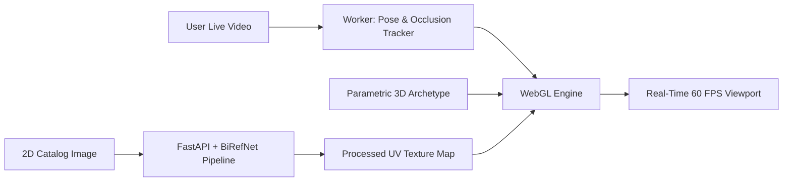
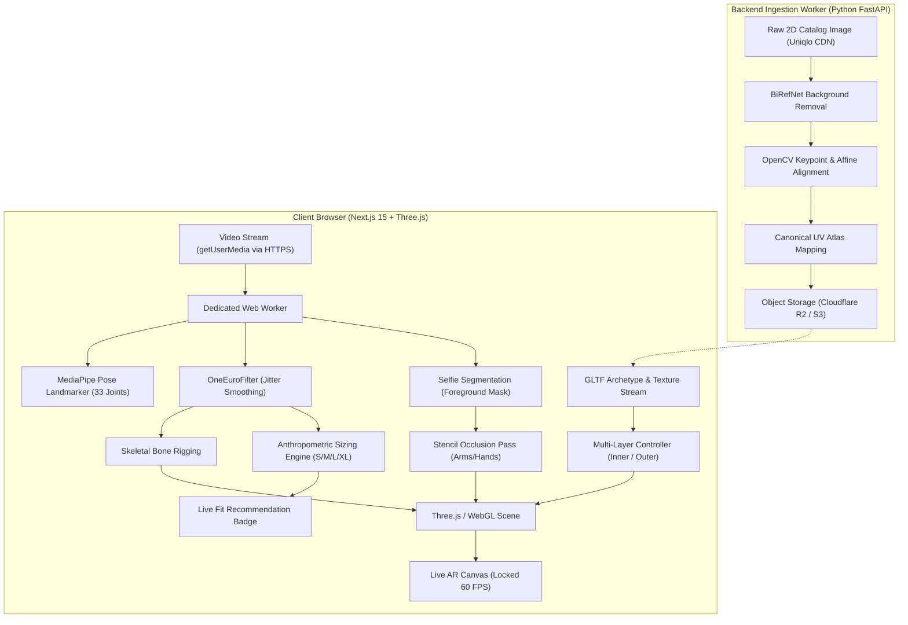
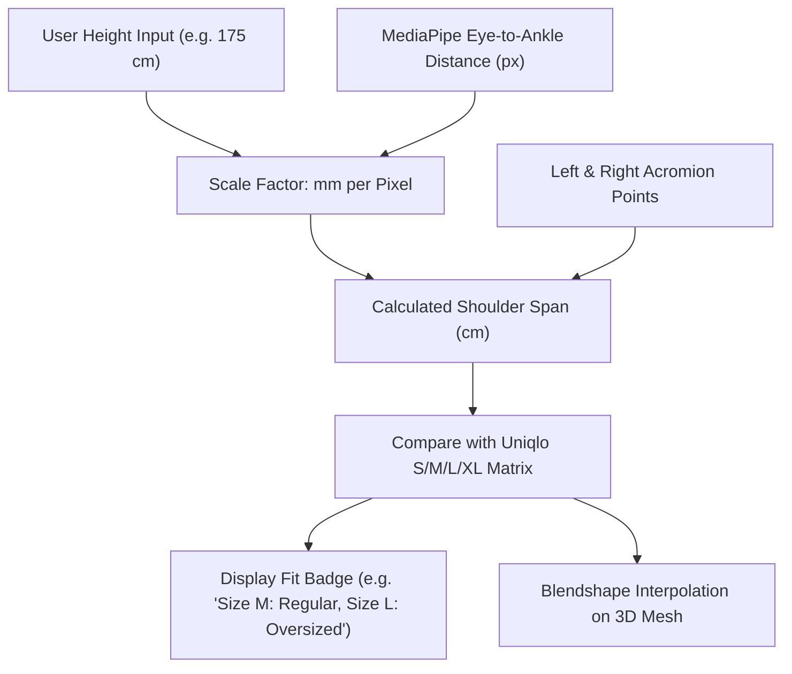
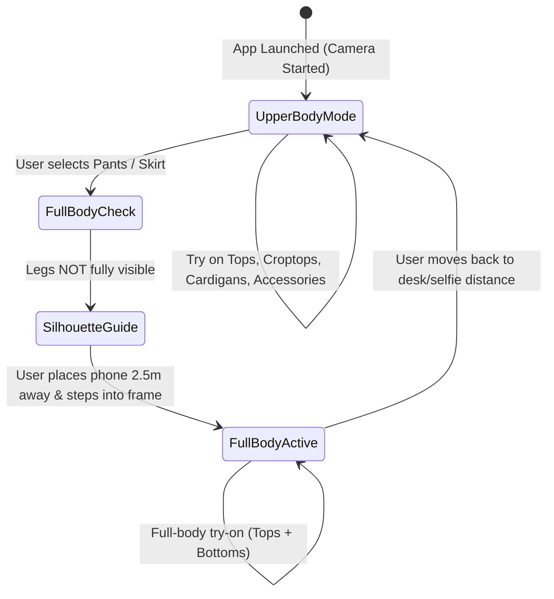

# Architecture & Technical Design Specification
## Real-Time E-Commerce Virtual Try-On (VTON) Engine

> **Document Version:** 2.0.0 (Post `/grill-me` Alignment)  
> **Status:** Approved for Implementation  
> **Target Audience:** Founding Engineering Team, Solution Architects, Tech Reviewers  
> **System Objective:** Client-side, zero-GPU-overhead, sub-30ms latency 3D/AR virtual try-on engine integrating existing 2D retail catalogs (e.g., Uniqlo) with multi-layering support (e.g., croptop + cardigan) and metric size recommendation.

---

## 1. Executive Summary & Core Engineering Thesis

### 1.1 The Core Problem
Traditional Generative AI Virtual Try-On (e.g., IDM-VTON, CatVTON) achieves high photorealism but is computationally prohibitive for real-time video (2–6s latency per frame, \$0.02–\$0.05 per inference). Conversely, traditional 3D AR requires dedicated 3D CAD modeling for every SKU, which fails against fast-fashion catalogs containing 50,000+ SKUs.

### 1.2 The Architectural Solution
This system decouples **Garment Geometry** from **Garment Surface**:
1. **Parametric Garment Archetypes:** A constrained set of rigged 3D base meshes (T-shirt, Croptop, Hoodie, Cardigan, Chino/Pants).
2. **Automated 2D-to-UV Projection:** An automated ingestion pipeline that transforms standard 2D flat-lay catalog imagery into texture maps for the base meshes.
3. **Client-Side WASM/WebGL Pipeline:** Real-time 60 FPS skeletal tracking and physics-approximation shader running entirely on the user's client hardware.



---

## 2. Definitive Architectural Decisions (From `/grill-me` Session)

| Dimension | Decision | Rationale |
| :--- | :--- | :--- |
| **Deployment Platform** | **Web Application (Next.js 15 + Three.js)** | Zero friction (no app install), runs in mobile Safari/Chrome & desktop webcams, can be linked directly from e-commerce pages. |
| **Catalog Strategy** | **Hybrid Ingestion** | 20 pre-processed benchmark Uniqlo SKUs for instant zero-latency demo + on-demand "Paste URL" background processing. |
| **Physics & Deformation** | **Skeletal Skinning + Radial Offset + Inertia Shader** | Guarantees locked 60 FPS on mobile browsers, prevents croptop/cardigan clipping via geometric offsets, zero risk of cloth simulation explosion. |
| **Sizing & Fit Engine** | **Calibrated Metric Sizing & Parametric Morphing** | Calibrates body dimensions from user height input; morphs base mesh blendshapes; delivers objective Uniqlo S/M/L/XL fit recommendations. |
| **Lower-Body UX** | **Dual-Mode UX (Upper-Body vs. Full-Body Standing)** | Upper-body works in standard desk/selfie view; picking bottom-wear switches to Full-Body Mode with a 2.5m standing alignment silhouette. |
| **Backend Ingestion** | **Python FastAPI + BiRefNet + OpenCV** | Headless scraper + state-of-the-art salient background removal + affine UV mapping, cached to Cloudflare R2 (~3–5s latency). |
| **Physical Device Testing** | **Next.js Experimental HTTPS / Cloudflare Tunnel** | Bypasses iOS Safari's strict HTTPS requirement for `getUserMedia` during local development on Windows PC. |

---

## 3. High-Level System Architecture



---

## 4. Detailed Component Breakdown

### 4.1 Client-Side Tracking & Motion Engine

* **WHAT it does:** Extracts skeletal landmarks and foreground masks from the raw video stream at native frame rates without blocking UI interactions.
* **WHY it was designed this way:** Running pose estimation directly on the main UI thread induces frame drops and input lag. Offloading to an `OffscreenCanvas` and `WebWorker` via WebAssembly (WASM) guarantees a consistent 60 FPS viewport.

#### Technical Specifications:
* **Pose Estimation:** Google MediaPipe Pose Landmarker (`pose_landmarker_heavy.task` on desktop, `pose_landmarker_full.task` on mobile).
* **Latency Mitigation (OneEuroFilter):**
  * Raw landmarks exhibit high-frequency jitter.
  * Standard low-pass filters introduce latency (lagging behind the user's movement).
  * The `OneEuroFilter` dynamically adjusts cutoff frequency based on movement speed: low cutoff during static poses (no jitter), high cutoff during rapid movements (zero lag).

---

### 4.2 Multi-Layer Garment Engine (Croptop + Cardigan)

* **WHAT it does:** Manages simultaneous rendering of multiple clothing items without visual interpenetration (mesh clipping).
* **WHY it was designed this way:** Users frequently style outfits in layers. Standard 3D rendering will cause two overlapping meshes bound to the same bones to clip through one another when the user twists or bends.

#### Layer Classification Matrix:

| Layer Slot | Target Garments | Radial Scale Offset | Depth Bias (`polygonOffset`) | Motion Response |
| :--- | :--- | :--- | :--- | :--- |
| **Layer 0 (Base)** | Underwear, Croptops, Singlets | $1.000\times$ (Skin fit) | Base (0) | Direct skinning |
| **Layer 1 (Mid)** | T-Shirts, Polos, Fitted Shirts | $1.035\times$ (+3.5% margin) | -1 | Subtle sway |
| **Layer 2 (Outer)** | Cardigans, Hoodies, Jackets | $1.075\times$ (+7.5% margin) | -2 | Inertia lag shader |
| **Layer 3 (Bottom)** | Shorts, Chinos, Skirts | Independent skeletal chain (Hips to Ankles) | 0 | Pelvis hinge |

#### Anti-Clipping Vertex Shader Formula:
To ensure the outer layer (Cardigan) never intersects with the inner layer (Croptop), the outer mesh vertices are displaced along their vertex normals:

$$\mathbf{v}_{\text{displaced}} = \mathbf{v}_{\text{base}} + (\mathbf{n} \cdot \delta_{\text{layer}})$$

Where $\mathbf{n}$ is the vertex surface normal and $\delta_{\text{layer}}$ is the calibrated layer extrusion distance ($8\text{mm} - 15\text{mm}$).

---

### 4.3 Anthropometric Sizing & Morphing Engine

* **WHAT it does:** Measures user shoulder span, torso height, and chest ratio in real time and maps them to Uniqlo's published size charts.
* **WHY it was designed this way:** Virtual try-on without fit advice leads to high e-commerce return rates. AI diffusion models hallucinate a flattering fit regardless of size; this geometric engine provides objective sizing feedback.



---

### 4.4 Occlusion & Depth Compositing

* **WHAT it does:** Ensures the user's hands, arms, phone, and hair remain in front of the virtual garment when positioned over the torso.
* **WHY it was designed this way:** Without occlusion handling, virtual clothes render on top of the user's arms, creating a broken visual illusion.

1. **Selfie Segmentation Mask:** A 256x256 binary mask separating person from background is generated per frame.
2. **Arm/Hand Extraction:** Body joint locations (wrists, elbows, index fingers) identify bounding boxes where user limbs exist.
3. **Stencil Buffer Pass:** Pixels within the limb bounding box write to a stencil mask, discarding 3D garment fragments that fall behind the user's physical limbs.

---

### 4.5 Dual-Mode UX Workflow



---

## 5. Technology Stack Summary

```
├── Frontend / Client Core: Next.js 15 (React 19) + TypeScript
├── 3D Rendering Engine: Three.js (r168) via @react-three/fiber
├── Computer Vision: @mediapipe/tasks-vision (WASM + WebGPU delegate inside Web Worker)
├── State Management: Zustand (Layer slots, active garment SKU, calibration parameters)
├── Styling & UI: Tailwind CSS + Lucide Icons
├── Backend Microservice: Python 3.11 + FastAPI + BiRefNet + OpenCV
├── Storage & Edge: Cloudflare R2 + Cloudflare Workers
└── Dev & Physical Testing: Next.js Experimental HTTPS / Cloudflare Tunnel
```

---

## 6. Implementation Roadmap & Milestones

### Phase 1: Foundation & Single-Layer AR (Week 1–2)
* Initialize Next.js 15 project with HTTPS configuration for physical iPhone testing.
* Set up MediaPipe Pose Landmarker inside a dedicated Web Worker.
* Bind a single T-Shirt GLTF base mesh to upper-body bones.
* Implement `OneEuroFilter` smoothing to eliminate skeletal jitter.

### Phase 2: Multi-Layer Stacking & Occlusion (Week 3–4)
* Implement Multi-Layer Controller (Inner Croptop + Outer Cardigan).
* Apply Normal Extrusion Shader + polygon depth bias to eliminate clipping.
* Implement stencil buffer occlusion for user hands and arms.

### Phase 3: Automated Ingestion Service (Week 5–6)
* Build FastAPI ingestion service: BiRefNet background stripping + OpenCV UV warping.
* Ingest 20 curated benchmark Uniqlo SKUs.
* Implement dynamic texture swapping in client viewport.

### Phase 4: Size Advisor & Dual-Mode Full Body (Week 7–8)
* Implement height-calibrated metric sizing engine and Uniqlo size chart mapping.
* Build Dual-Mode UX transition with full-body standing silhouette guide.
* Polish UI/UX and mobile performance optimization.
